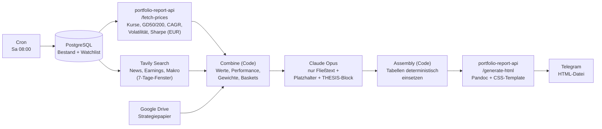
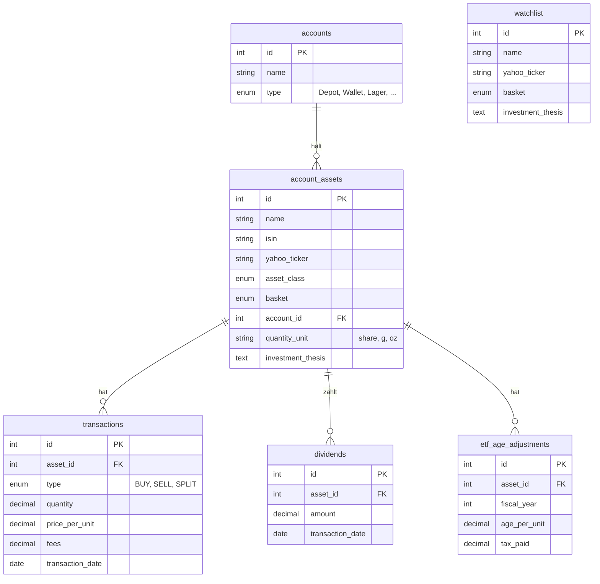
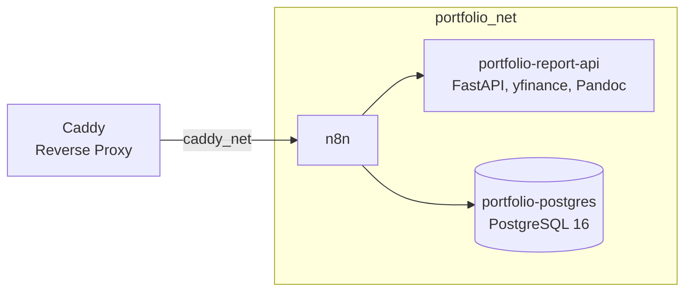

# Personal Portfolio Report

Automatisierter wöchentlicher Börsenbrief für ein privates Core-Satellite-Portfolio. Jeden Samstag um 08:00 sammelt ein n8n-Workflow Bestände, Kurse, News und die Anlagestrategie, lässt Claude Opus den Fließtext schreiben und schickt den fertigen Bericht als HTML-Datei per Telegram.

Kernidee: **Das LLM berührt keine Zahl.** Alle Kennzahlen und Tabellen werden deterministisch berechnet und gesetzt. Opus schreibt nur Prosa und Platzhalter.

## Workflow

| Schritt | Aufgabe |
|---|---|
| PostgreSQL | Lädt Bestand und Watchlist in einer Abfrage (`UNION ALL`). Menge und Einstandspreis werden aus `transactions` berechnet |
| portfolio-report-api | FastAPI + yfinance. Liefert alle Preise und Metriken in EUR (Frankfurt-Ticker, USD-Assets über `EURUSD=X` umgerechnet) und klassifiziert den Trend (bullish, correction, weakening, ...) |
| Tavily | News je Position plus Makro- und Zinsthemen |
| Combine | Berechnet Positionswert, Performance, Gewichtung, Wochen-Performance und Basket-Aggregate |
| Claude Opus | Schreibt den Bericht als Markdown mit Platzhaltern wie `[[TABELLE:EINZELWERTE]]` und `[[GESAMTWERT]]` sowie einem unsichtbaren Block mit Thesis-Verdikten (intakt / angeschlagen / gebrochen) |
| Assembly | Baut die Tabellen im deutschen Zahlenformat und ersetzt die Platzhalter |
| /generate-html | Pandoc + CSS/JS-Template, farbcodierte Trend-, Thesis- und Performance-Werte |

## Datenmodell

- **Bestand und Einstandspreis** werden nicht gespeichert, sondern aus `transactions` abgeleitet. Gebühren erhöhen den Einstandspreis (österreichische Steuerlogik), Splits sind Transaktionen mit `price_per_unit = 0`.
- **AgE** (ausschüttungsgleiche Erträge thesaurierender ETFs) erhöhen den steuerlichen Einstandspreis und verhindern so eine Doppelbesteuerung beim Verkauf.
- `watchlist` ist ähnlich aufgebaut wie `account_assets`, hat aber kein Konto.

## Infrastruktur

Alle Dienste laufen als Docker-Stacks auf einem VPS und sprechen über das interne Netzwerk `portfolio_net` miteinander. Nach außen ist nur n8n über Caddy (`caddy_net`) erreichbar.

## Repository-Inhalt

| Pfad | Inhalt |
|---|---|
| `n8n/Portfolio_Report_Weekly_2.json` | Exportierter n8n-Workflow |
| `n8n/docs/n8n.md` | n8n-Stack, Kosten, Designentscheidungen |
| `n8n/docs/portfolio-report-api.md` | API-Stack, EUR-Konsistenz, HTML-Rendering |
| `n8n/docs/assetmanagement.md` | PostgreSQL-Stack und Datenbankschema |

API-Code, Docker-Compose-Dateien und das SQL-Schema liegen in einem separaten Infrastruktur-Repository.

## Kosten

Bei 15 Positionen und wöchentlichem Report ca. **0,38 USD pro Woche**. Tavily kommt mit dem kostenlosen Researcher-Tier aus, yfinance ist ebenfalls kostenlos, die Kosten entfallen damit im Wesentlichen auf Claude Opus.

Mehr Positionen oder häufigere Läufe erhöhen die Kosten entsprechend, sowohl beim Opus-Aufruf als auch bei den Tavily-Suchanfragen (dann ggf. über das Freikontingent hinaus).
