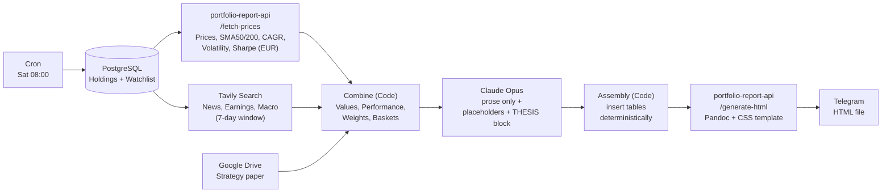
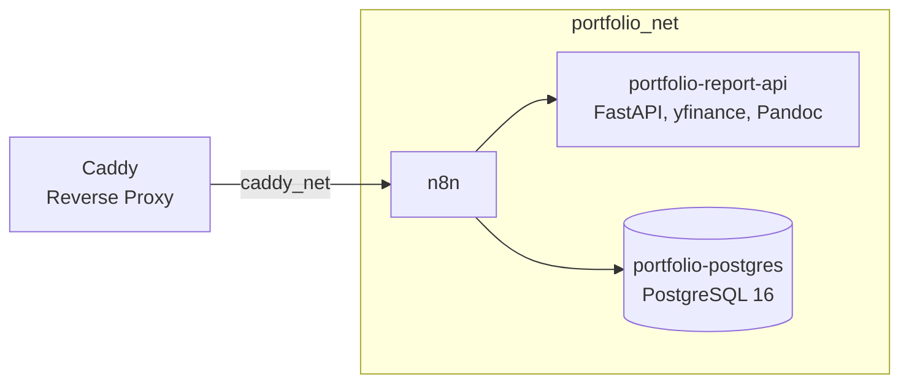

# Personal Portfolio Report

Automated weekly market newsletter for a private core-satellite portfolio. Every Saturday at 08:00, an n8n workflow gathers holdings, prices, news and the investment strategy, has Claude Opus write the narrative, and sends the finished report as an HTML file via Telegram.

Core idea: **The LLM never touches a number.** All metrics and tables are calculated and inserted deterministically. Opus only writes prose and placeholders.

The report itself is written in German.

## Workflow

| Step | Purpose |
|---|---|
| PostgreSQL | Loads holdings and watchlist in a single query (`UNION ALL`). Quantity and cost basis are derived from `transactions` |
| portfolio-report-api | FastAPI + yfinance. Returns all prices and metrics in EUR (Frankfurt tickers, USD assets converted via `EURUSD=X`) and classifies the trend (bullish, correction, weakening, ...) |
| Tavily | News per position plus macro and interest-rate topics |
| Combine | Calculates position value, performance, weighting, weekly performance and basket aggregates |
| Claude Opus | Writes the report as Markdown with placeholders such as `[[TABELLE:EINZELWERTE]]` and `[[GESAMTWERT]]`, plus a hidden block with thesis verdicts (intact / damaged / broken) |
| Assembly | Builds the tables in German number format and replaces the placeholders |
| /generate-html | Pandoc + CSS/JS template, color-coded trend, thesis and performance values |

## Data Model

- **Holdings and cost basis** are not stored but derived from `transactions`. Fees increase the cost basis (Austrian tax rules); splits are transactions with `price_per_unit = 0`.
- **AgE** (*ausschüttungsgleiche Erträge*, deemed distributions of accumulating ETFs) increase the tax cost basis and thereby prevent double taxation on sale.
- `watchlist` is structured similarly to `account_assets` but has no account.

## Infrastructure

All services run as Docker stacks on a VPS and communicate over the internal network `portfolio_net`. Only n8n is exposed externally, via Caddy (`caddy_net`).

## Repository Contents

| Path | Contents |
|---|---|
| `n8n/Portfolio_Report_Weekly_2.json` | Exported n8n workflow |
| `n8n/docs/n8n.md` | n8n stack, costs, design decisions |
| `n8n/docs/portfolio-report-api.md` | API stack, EUR consistency, HTML rendering |
| `n8n/docs/assetmanagement.md` | PostgreSQL stack and database schema |

API code, Docker Compose files and the SQL schema live in a separate infrastructure repository.

## Costs

With 15 positions and a weekly report, roughly **USD 0.38 per week**. Tavily fits within the free Researcher tier and yfinance is free as well, so the cost is essentially Claude Opus.

More positions or more frequent runs increase the cost accordingly, both for the Opus call and for Tavily searches (possibly exceeding the free quota).

## License

[MIT](LICENSE)
